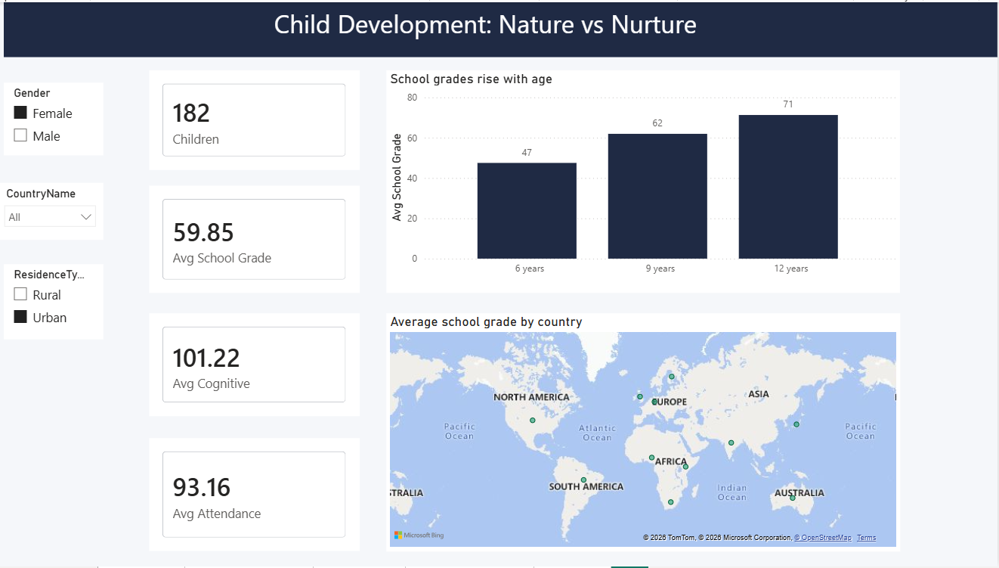
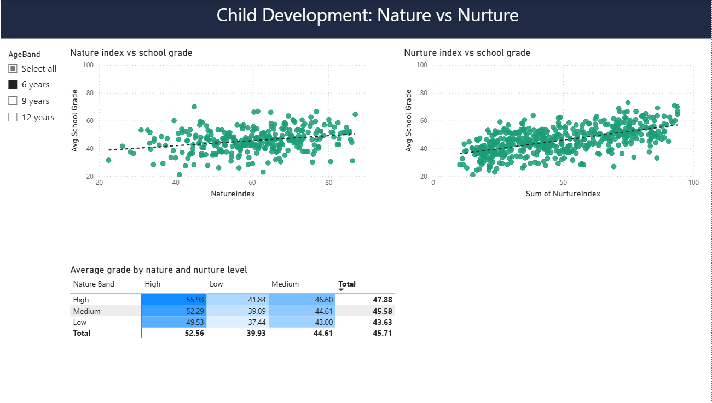
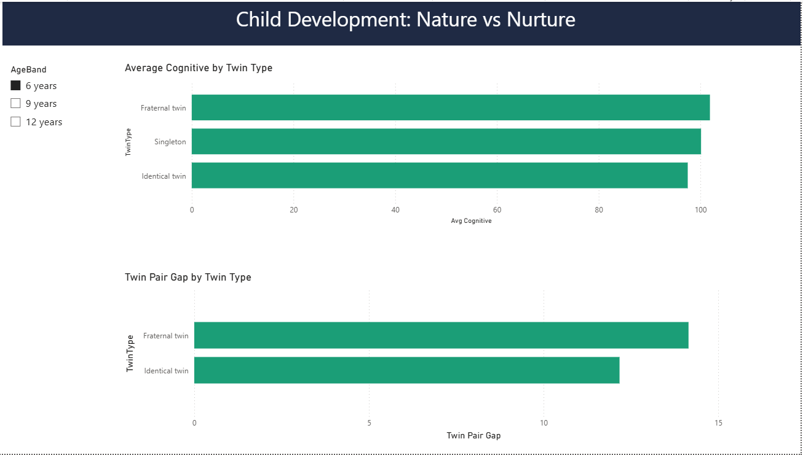
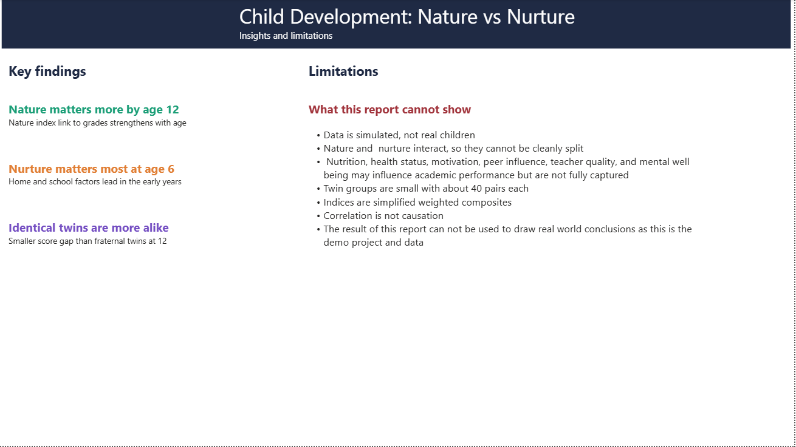

# Child Development: Nature vs Nurture

## Project Overview

This project explores child development through nature versus nurture, using Microsoft Power BI to analyse and visualise data related to children's development.

The objective is to explore patterns and relationships in child development data and demonstrate how data analytics and visualisation can support a better understanding of developmental outcomes.

## Objectives

- Explore factors associated with child development.
- Analyse relationships between different developmental indicators.
- Identify patterns and differences across relevant categories.
- Present insights through interactive Power BI visualisations.
- Demonstrate practical data analytics and reporting skills.

## Tools and Technologies

- **Microsoft Power BI** – Data visualisation and interactive reporting.
- **Power Query** – Data preparation and transformation.
- **DAX** – Calculated measures and analytical calculations.
- **Data Modelling** – Organising data for analysis.

## Dashboard Preview

## Key Analytical Areas

The project investigates child development indicators and explores how different factors may relate to developmental outcomes.

## How to View the Project

1. Download the `.pbix` file from this repository.
2. Install Microsoft Power BI Desktop.
3. Open the downloaded file using Power BI Desktop.
4. Interact with the report and explore its visualisations.

## Skills Demonstrated

- Data analysis and interpretation
- Data cleaning and transformation
- Data modelling
- DAX calculations
- Data visualisation
- Analytical thinking and insight generation

[GitHub Profile](https://github.com/)

